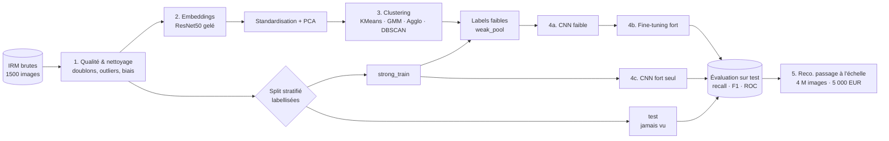
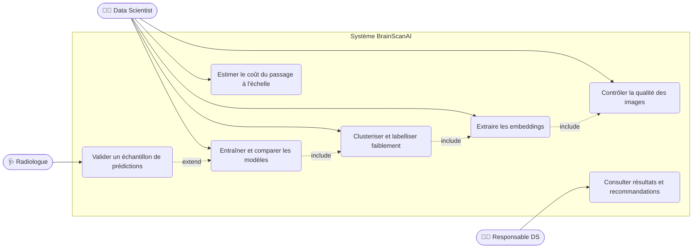
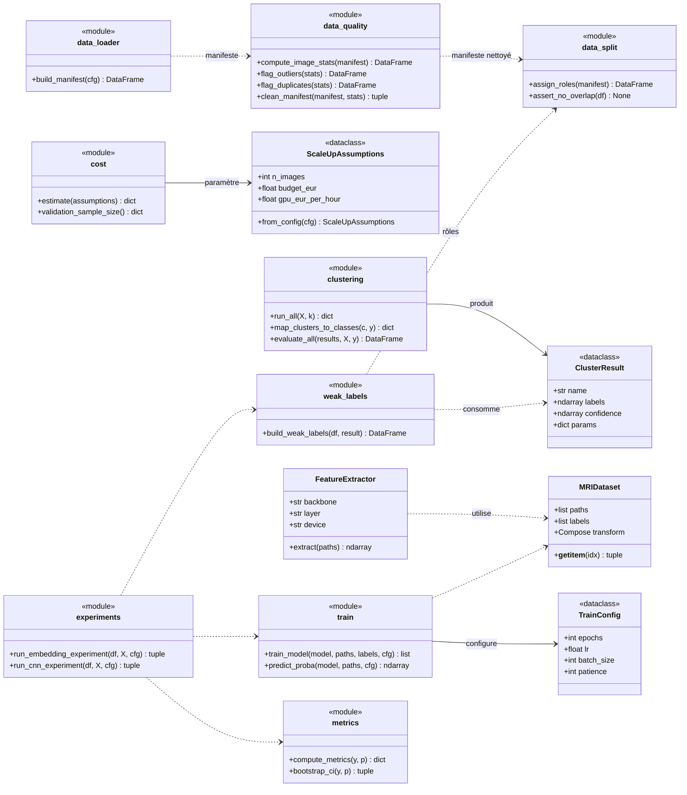
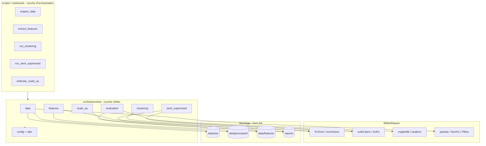
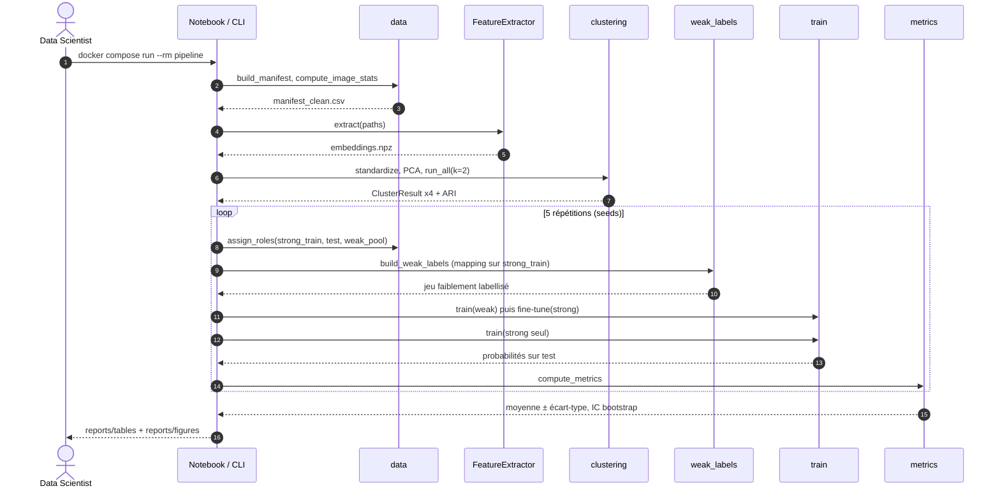
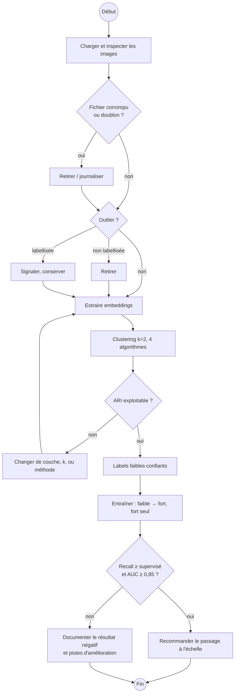
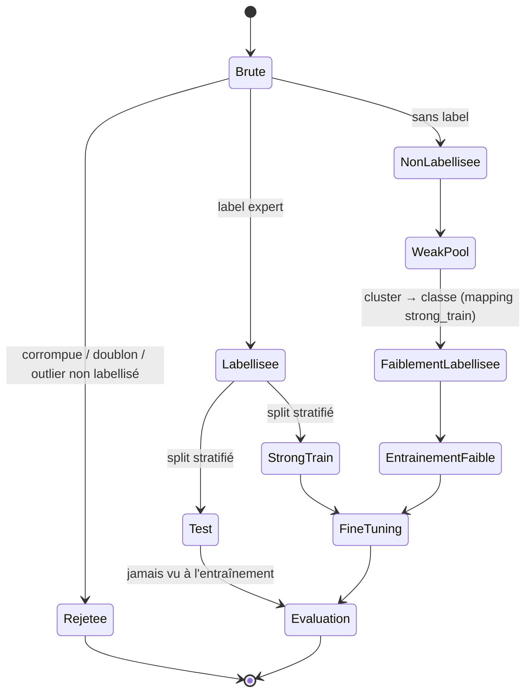
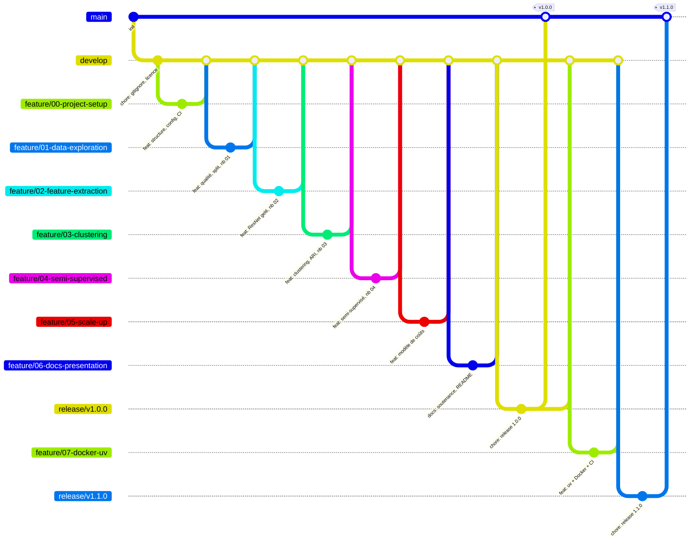
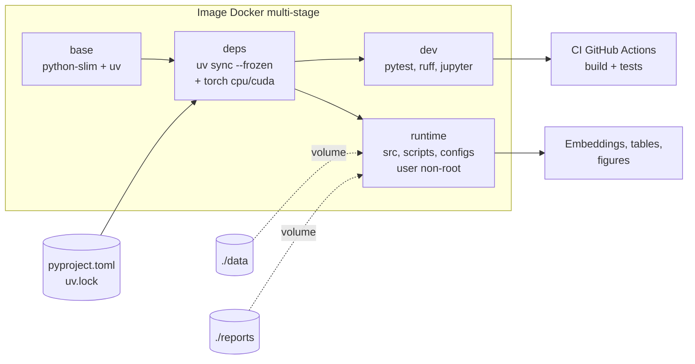

<p align="center">
  
</p>

<p align="center">
  
  
  
  
  
  
  
  
  
  
  
  
  
  
</p>

# 🧠 BrainScanAI - Détection de tumeurs cérébrales par apprentissage semi-supervisé

> Projet R&D de **CurelyticsIA** (mission fictive, parcours Data Scientist). Exploration analytique d'IRM cérébrales : **1 400 images non labellisées + 100 labellisées** (normal / cancer). Objectif : tirer parti des images sans label via des embeddings pré-entraînés, du clustering et des méthodes semi-supervisées, puis évaluer la faisabilité d'un passage à l'échelle (**4 M d'images, 5 000 EUR**).

> ⚠️ **Projet de recherche / pédagogique - aucune valeur diagnostique.** Toute utilisation clinique relève de la réglementation des dispositifs médicaux.

---

## 📑 Sommaire
1. [Objectifs et livrables](#-objectifs-et-livrables)
2. [Données](#-données)
3. [Architecture du projet](#-architecture-du-projet)
4. [Pipeline et méthodologie](#-pipeline-et-méthodologie)
5. [Diagrammes UML](#-diagrammes-uml)
6. [Stratégie Git / GitHub](#-stratégie-git--github)
7. [Installation et exécution (Docker uniquement)](#-installation-et-exécution-docker-uniquement)
8. [Métriques et definition of done](#-métriques-et-definition-of-done)
9. [Passage à l'échelle](#-passage-à-léchelle-4-m-dimages--5-000-eur)
10. [Résultats](#-résultats)
11. [Tests et qualité](#-tests-et-qualité)
12. [Limites et suites](#-limites-et-suites)

---

## 🎯 Objectifs et livrables

| # | Objectif (mail de Clara Martin) | Livrable | Emplacement |
|---|---|---|---|
| 1 | Explorer les images, vérifier qualité/format | Notebook préparation | `notebooks/01_exploration_preparation.ipynb` |
| 2 | Extraire des features (ResNet pré-entraîné) + preprocessing | Notebook features | `notebooks/02_extraction_features.ipynb` |
| 3 | Clustering exploratoire (K-Means, DBSCAN...) + ARI | Notebook non supervisé | `notebooks/03_clustering_non_supervise.ipynb` |
| 4 | Semi-supervisé (CNN faible → fort vs supervisé) | Notebook semi-supervisé | `notebooks/04_semi_supervise.ipynb` |
| 5 | Support + recommandations de passage à l'échelle | Plan de présentation + modèle de coûts | `docs/presentation_outline.md`, `reports/` |
| 6 | Fiche d'auto-évaluation | Correspondance indicateurs ↔ preuves | `docs/autoevaluation_checklist.md` |

**Contraintes respectées** : Python, plusieurs algorithmes comparés, métriques justifiées par le risque clinique, *definition of done* explicite ([docs/definition_of_done.md](docs/definition_of_done.md)).

## 🗂️ Données

Source : « Jeu de données d'images cérébrales pour la détection de tumeurs » (usage académique libre) - 1 500 images JPEG 512×512 : **1 400 non étiquetées**, **100 étiquetées** (`Normal` / `Cancer`).

Arborescence attendue (non versionnée) :

```text
data/raw/
├── labeled/
│   ├── normal/   *.jpg
│   └── cancer/   *.jpg
└── unlabeled/    *.jpg
```

> 📝 L'énoncé de la mission évoque du PNG + métadonnées, le descriptif du jeu annonce du JPEG : le notebook 01 **vérifie** format, résolution et canaux. Sans le vrai jeu, `docker compose run --rm demo-data` génère des images **synthétiques** (smoke test uniquement).

## 🏗️ Architecture du projet

```text
brainscanai/
├── README.md
├── LICENSE
├── Makefile                      # raccourcis optionnels (dev local / Linux-macOS) ; Docker n'en a pas besoin
├── pyproject.toml                # dépendances, groupes dev/notebooks (uv), ruff, pytest
├── uv.lock                       # versions verrouillées (reproductibilité)
├── .python-version               # version de Python utilisée par uv
├── Dockerfile                    # multi-stage : deps → runtime / dev, torch CPU ou CUDA
├── docker-compose.yml            # un service par étape + test + jupyter + profil GPU
├── .dockerignore
├── .gitignore                    # données et poids jamais versionnés
├── .github/
│   ├── workflows/ci.yml          # uv : lint + tests + notebooks, puis build Docker
│   └── pull_request_template.md
├── configs/
│   └── config.yaml               # chemins, backbone, clustering, CNN, budget (source unique de vérité)
├── data/
│   ├── raw/{labeled,unlabeled}/  # images brutes (hors Git)
│   ├── processed/                # manifeste nettoyé, stats qualité, assignations de clusters
│   └── features/                 # embeddings (.npz)
├── notebooks/                    # 01 → 04 (générés par scripts/build_notebooks.py, sans sorties)
├── src/brainscanai/
│   ├── config.py · utils.py
│   ├── data/            loader.py · quality.py · split.py · dataset.py
│   ├── features/        extractor.py (PyTorch) · io.py
│   ├── clustering/      reduce.py · cluster.py · evaluate.py
│   ├── semi_supervised/ weak_labels.py · sklearn_methods.py · embedding_experiment.py
│   │                    models.py · train.py · cnn_experiment.py
│   ├── evaluation/      metrics.py · plots.py
│   └── scale_up/        cost.py
├── scripts/                      # CLI : inspect_data, extract_features, run_clustering,
│                                 #       run_semi_supervised, estimate_scale_up, make_demo_data,
│                                 #       build_notebooks, check_notebooks
├── tests/                        # pytest (qualité, split anti-fuite, clustering, métriques, coûts)
├── docs/                         # workflow Git, definition of done, auto-évaluation, plan de soutenance
└── reports/{figures,tables,presentation}/
```

## 🔬 Pipeline et méthodologie



**Règles anti-fuite (non négociables)**
- Les images labellisées sont scindées en `strong_train` / `test` (stratifié) ; les non labellisées forment `weak_pool`. Un garde-fou (`assert_no_overlap`) interdit tout chevauchement.
- Le mapping *cluster → classe* est appris **uniquement** sur `strong_train`.
- Les labels « faibles » restent dans un jeu séparé du jeu « fort » et sont réintroduits avec un poids réduit ou en pré-entraînement.
- Le test n'est jamais utilisé pour l'entraînement, le choix de seuil ou le mapping. Résultats moyennés sur **5 répétitions** (seeds/splits différents) car le test est petit (≈ 30 images).

**Approches comparées** : régression logistique supervisée (référence), labels faibles seuls, faible + fort pondéré, *self-training* (pseudo-labelling à seuil de confiance), *Label Spreading*, *Label Propagation*, et CNN (ResNet18) **faible → fort** vs **fort seul**.

## 📐 Diagrammes UML

### Diagramme de cas d'utilisation



### Diagramme de classes



### Diagramme de paquetages / composants



### Diagramme de séquence - exécution du pipeline



### Diagramme d'activité - décisions clés



### Diagramme d'états - cycle de vie d'une image



## 🌿 Stratégie Git / GitHub

Git Flow allégé : une branche `feature/*` par étape, PR vers `develop`, versions livrables taguées sur `main`. Détails : [docs/git_workflow.md](docs/git_workflow.md).

| Branche | Étape | Contenu |
|---|---|---|
| `feature/00-project-setup` | Cadrage | Arborescence, config, CI, utilitaires, graphiques |
| `feature/01-data-exploration` | 1 | Manifeste, qualité, split anti-fuite, notebook 01 |
| `feature/02-feature-extraction` | 2 | Backbone gelé, embeddings, notebook 02 |
| `feature/03-clustering` | 3 | PCA/t-SNE, clustering, ARI, labels faibles, notebook 03 |
| `feature/04-semi-supervised` | 4 | Métriques, méthodes sklearn, CNN faible→fort, notebook 04 |
| `feature/05-scale-up` | Échelle | Modèle de coûts 4 M images / 5 000 EUR |
| `feature/06-docs-presentation` | Livrables | Docs, auto-évaluation, plan de soutenance, README |
| `feature/07-docker-uv` | Industrialisation | uv (`uv.lock`), Dockerfile multi-stage, docker-compose, CI mise à jour |
| `release/v1.0.0`, `release/v1.1.0` → `main` | Release | Tags `v1.0.0`, `v1.1.0` |



## 🐳 Installation et exécution (Docker uniquement)

**Seul Docker est requis** sur votre machine (Windows, macOS ou Linux). **Aucune installation locale de Python, uv, PyTorch ou `make`** : toutes les dépendances (verrouillées par `uv.lock`) sont installées **dans l'image** au premier build.

**Prérequis** : [Docker Desktop](https://www.docker.com/products/docker-desktop/) installé et lancé (Windows : backend WSL2).

```powershell
git clone <votre-repo>.git ; cd brainscanai

# 1) Données : copier le jeu dans data/raw/ (voir arborescence) - OU générer un jeu synthétique de test
docker compose run --rm demo-data

# 2) Tout le pipeline en une commande (le 1er lancement construit l'image : plusieurs minutes, PyTorch est lourd)
docker compose run --rm pipeline

# ... ou étape par étape
docker compose run --rm inspect       # 1. qualité + nettoyage
docker compose run --rm features      # 2. embeddings ResNet
docker compose run --rm cluster       # 3. clustering + ARI + figures
docker compose run --rm semi          # 4. supervisé vs semi-supervisé (CNN inclus)
docker compose run --rm scaleup       # 5. budget 4 M d'images

# Tests et notebooks, toujours dans un conteneur
docker compose run --rm test          # ruff + pytest
docker compose up jupyter             # JupyterLab -> http://localhost:8888
```

- Les dossiers `data/` et `reports/` de votre machine sont **montés en volumes** : résultats (`reports/figures`, `reports/tables`) et embeddings apparaissent directement chez vous ; les données ne sont jamais copiées dans l'image. Les poids ImageNet sont mis en cache dans `data/.torch_cache`.
- Modifier `src/` ou `scripts/` ? Reconstruire : `docker compose build` (le service `jupyter` monte le code en direct).
- Paramètres : `configs/config.yaml` (monté en lecture seule, pas de rebuild nécessaire).
- **GPU** (NVIDIA Container Toolkit requis) : `$env:TORCH_VARIANT="cu121"; docker compose build inspect` puis `docker compose --profile gpu run --rm features-gpu` (PowerShell ; sous bash : `TORCH_VARIANT=cu121 docker compose ...`).
- Test hors-ligne sans poids pré-entraînés : `docker compose run --rm features python scripts/extract_features.py --no-pretrained`.



### Option : développement local sans Docker (facultatif)

Réservé à l'autocomplétion IDE ou au débogage : `uv sync --group dev --group notebooks`, puis `uv run python scripts/<script>.py` (ou `make <cible>` si `make` est disponible). Ce n'est **pas** nécessaire pour exécuter le projet.

## 📏 Métriques et definition of done

**Classe positive = cancer.** L'erreur la plus grave est le **faux négatif** (tumeur non détectée) :

| Rôle | Métrique | Raison |
|---|---|---|
| **Principale** | Rappel (sensibilité) « cancer » | Minimiser les tumeurs manquées |
| Garde-fou | Précision, spécificité | Éviter de submerger les radiologues de faux positifs |
| Synthèse | F1 et F2 (pondère le rappel) | Compromis |
| Indépendante du seuil | AUC-ROC, AUC-PR | Comparer les modèles sans fixer le seuil |
| Clustering | ARI, NMI, pureté, silhouette | Externe (sur les 100 labels) et interne |
| Incertitude | IC 95 % bootstrap | Test ≈ 30 images : un chiffre seul serait trompeur |

L'accuracy est rapportée mais **jamais** utilisée seule. Le seuil de décision (ex. rappel ≥ 95 %) se calibre sur la validation, pas sur le test.

**Definition of done** ([détail](docs/definition_of_done.md)) : pipeline reproductible, zéro fuite, ≥ 3 clusterings et ≥ 3 approches semi-supervisées comparées sur 5 répétitions, semi-supervisé ≥ supervisé en rappel avec AUC-ROC ≥ 0,85 - **ou** résultat négatif analysé et argumenté.

## 💶 Passage à l'échelle (4 M d'images / 5 000 EUR)

- Budget disponible : **0,00125 EUR/image** contre **0,20 EUR/image** au pilote (300 EUR / 1 500) → extrapolation naïve = **800 000 EUR** : un étiquetage payé à l'image est exclu.
- **Faisable sous conditions** : labellisation automatique auto-hébergée (embeddings + pseudo-labels), puis budget restant consacré à une **revue experte ciblée** (validation statistique ≈ 146 images pour un rappel de 95 % à ± 5 %, + cas à faible confiance), suivi du décalage de domaine, statut « R&D » des labels.
- Chiffrage et sensibilité : `python scripts/estimate_scale_up.py` → `reports/tables/scale_up_*.csv`. **Tous les tarifs sont des hypothèses** (`configs/config.yaml`, section `scale_up`) à remplacer par des devis réels.
- Synthèse : [docs/scale_up_recommendations.md](docs/scale_up_recommendations.md).

## 📊 Résultats

> Les résultats sur le jeu réel **ne sont pas encore produits** : le dépôt livre le pipeline, pas des chiffres inventés. Après exécution, reporter ici les tableaux générés dans `reports/tables/`.

| Approche | Rappel cancer | F1 | AUC-ROC |
|---|---|---|---|
| Supervisé (labels forts seuls) | _à compléter_ | _à compléter_ | _à compléter_ |
| Semi-supervisé (meilleure approche) | _à compléter_ | _à compléter_ | _à compléter_ |

## ✅ Tests et qualité

```bash
docker compose run --rm test    # ruff + pytest dans le conteneur : qualité/doublons, split anti-fuite, clustering, mapping, métriques, coûts, pipeline embeddings
```
La CI GitHub Actions (uv, `--frozen`) exécute lint + tests + validation des notebooks (sans sorties), puis construit l'image Docker, à chaque push/PR. Les tests PyTorch sont ignorés automatiquement si `torch` n'est pas installé.

## 🚧 Limites et suites

- **100 labels** : variance élevée, test ≈ 30 images → conclusions prudentes, IC larges, répétitions indispensables.
- Les clusters peuvent refléter l'intensité, la coupe ou le scanner plutôt que la pathologie (à vérifier visuellement, notebook 03).
- Risque de décalage de domaine entre labellisées et non labellisées (test KS, notebook 01).
- Pistes : couches intermédiaires, modèles pré-entraînés médicaux, FixMatch/MixMatch, apprentissage actif, calibration, explicabilité (Grad-CAM).

---
<sub>Licence MIT · Données : usage académique libre · Auteur : Data Scientist junior, CurelyticsIA.</sub>
